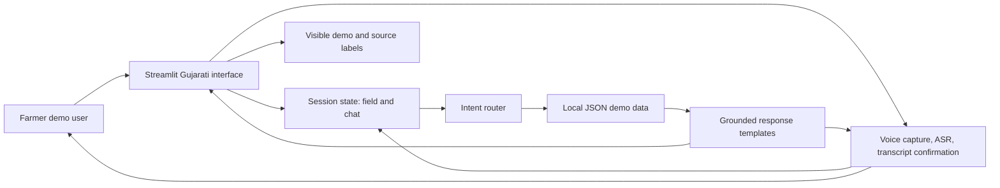
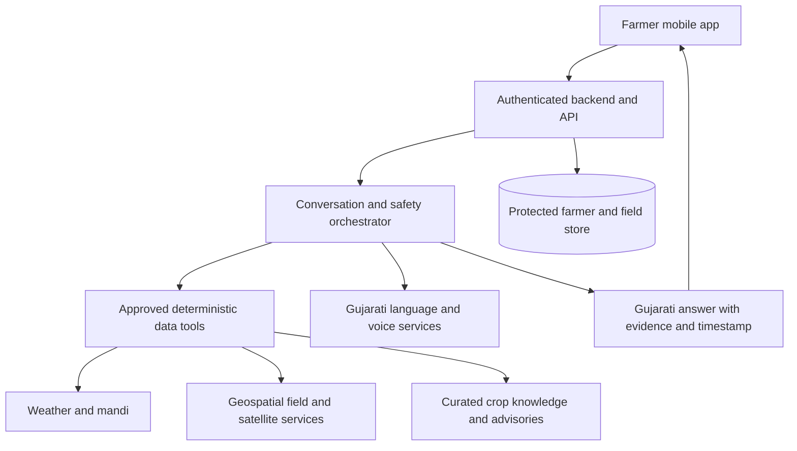

# BHOMI — Autonomous Khedut Agent
## Codex-ready prototype roadmap (Streamlit, Gujarati-first)

**Purpose:** improve the existing Streamlit prototype into a convincing, usable client demo. This revision is based on the screenshots supplied on 2026-10-06 and is both an audit and an implementation brief for Codex.

**Prototype boundary:** this is a local Streamlit web demo with curated, clearly labelled demonstration data. It is not a production agronomy system, does not identify real farms or farmers, and must not present simulated weather, prices, satellite readings, or diagnoses as live facts. Flutter is a possible later mobile optimization; do not use Flutter for this prototype.

---

## 1. Product understanding and audit

BHOMI’s strongest product idea is not “a chatbot with many agriculture features.” It is **one familiar Gujarati conversation that can use a farmer’s field context**. The first prototype should make that promise tangible through a coherent farmer journey: see a sample farm, ask what to do, get an understandable Gujarati answer with a reason, and optionally speak/listen.

### What is already well specified

- Primary user: a farmer in/around Kheralu, Gujarat, who may prefer speech and simple Gujarati.
- Core interaction: Gujarati speech or text → contextual answer → Gujarati text and voice playback.
- Useful context: farmer/field profile, crop and stage, weather, previous observations, local prices, trusted advisories.
- High-value capabilities: onboarding/practice, field mapping, field dashboard, crop photo triage, alerts, mandi prices, decision support.
- Non-negotiable qualities: explain reasons, show uncertainty, protect location and personal data, keep the interface approachable.

### Key decisions and risks to resolve after the demo

1. **Agronomy governance:** who reviews and approves crop-specific advice, treatment language, thresholds, and source citations? The prototype must not invent pesticide or fertilizer dosages.
2. **Gujarati quality:** local Kheralu vocabulary, crop names, speech recognition, pronunciation, code-mixing, and literacy need testing with actual farmers. A model claiming “Gujarati support” does not prove it understands this community’s accent.
3. **Data access and freshness:** live mandi, weather, advisories, satellite, and disease reports each need a source, timestamp, licence/terms review, outage behavior, and matching by location/crop. A source name alone does not make data available or current.
4. **Field mapping and satellite:** drawing a polygon is a UI task; calculating area and validating geometry is a geospatial task. Satellite monitoring requires a provider, imagery history, cloud masking, spatial processing, calibration, and agronomic interpretation. None should be implied by a static map in this demo.
5. **Voice and emotion:** voice output can sound warm through concise, respectful Gujarati and natural pacing. The system should infer distress only from explicit words/context and respond with care; it must not claim to detect a person’s emotional state from voice in this prototype.
6. **Privacy and consent:** exact farm coordinates and photos are sensitive. The demo uses fictional data and should not ask the client to enter real farmer data. Production needs consent, retention/deletion rules, access controls, audit trails, and a threat model.

### Screenshot audit and priority gaps

The screenshots show that the project already has a warm natural-color dashboard, Gujarati/English selection, field cards and illustrative boundary, assistant page, and cautious crop-photo sample review. Those are useful foundations. The assistant screenshot also shows a visible failure: **“The recording could not be transcribed. Try again or type your question.”** The screen says the demo server transcribes voice, but gives no transcript preview, actionable cause, or working path to spoken reply. That is the primary blocker because voice is a core product promise, not a decorative microphone icon.

Other gaps visible or implied by the screenshots:

- The voice promise is ambiguous: users cannot tell which language is selected for recognition and playback, whether the microphone recording completed, or whether audio is being sent for transcription.
- A text-only fallback exists, but the failure state does not let the user inspect/edit a transcript or clearly retry a voice response.
- The prototype’s sample-data labels and crop-photo uncertainty are good trust signals; preserve them. The map shown is explicitly an illustration, so do not describe it as a working farm-boundary survey.
- The photo page retains illustrative sample cases and adds an explicit Groq vision review for uploaded photos. Describe it as approximate visible-area observation, never as a live diagnosis.
- The screenshots do not prove why transcription failed. Codex must inspect the current code and terminal logs before changing libraries. Likely areas to check include missing/unloaded ASR model, audio bytes not reaching the transcriber, unsupported encoding/sample rate, language not passed to ASR, lost widget/session state after Streamlit rerun, exception handling that hides the cause, or a success path that never sends the transcript to chat. These are hypotheses, not confirmed causes.

### Demo acceptance target

In a 3–5 minute walkthrough, a viewer can:

- understand the BHOMI promise from the first screen;
- choose a fictional Kheralu farm and see a useful Gujarati dashboard;
- ask a supported question in Gujarati text and receive a contextual, natural Gujarati response;
- select Gujarati or English, record a short voice sample, review/edit the actual transcript, submit it, see the assistant answer in the chosen language, and play the answer aloud;
- receive a specific, recoverable message if recording, transcription, answer generation, or speech playback fails;
- try a crop photo and see a cautious demo triage result, labelled as a sample rather than a verified diagnosis;
- complete a short tutorial/practice checklist and understand which data is simulated.

---

## 2. Scope: build tonight vs. later

### Build now

- Streamlit single-page responsive demo, optimized for laptop presentation and usable on a phone-sized browser.
- Gujarati-first UI with a small English language toggle only if it can be implemented without diluting the Gujarati experience.
- Fictional farmer and field selector; sample cotton and wheat fields around Kheralu.
- Dashboard cards for crop stage/health observation, irrigation cue, weather, recent farm activity, alerts, and mandi sample.
- Conversational text assistant with intent routing and retrieval from local JSON demo records. Responses should be templated/grounded rather than open-ended advice.
- Complete turn-based voice loop: microphone recording, working Gujarati/English transcription, transcript confirmation/editing, answer through the same handler as typed chat, and spoken response in the selected language. Do not imply real-time duplex voice.
- Crop photo upload with a fixed, cautious sample result by default. A real vision model is called only after an explicit Analyze action, only with the server-side Groq key configured, and only with a vision-capable model. Remove EXIF/location metadata first and label marked regions as approximate visual observations, not diagnosis.
- Interactive field boundary sketch using a simple Leaflet/Polygon drawing component if it is quick and reliable. Provide a static illustrative boundary fallback if the map component fails. Use fictional coordinates only.
- Tutorial that guides and checks off actual demo actions.
- Clean states: loading, empty, success, unavailable, stale/sample data, and errors.
- README with setup and demo run instructions.

### Explicitly out of scope tonight

- Real farmer accounts, OTP/authentication, database persistence, deployed public service, production security claims.
- Real satellite imagery, NDVI/stress maps, flood detection, historical change analysis, or verified area measurement.
- Live mandi quote claims or price forecasting.
- Automatic disease identification, treatment prescriptions, chemical dosage, or guaranteed crop advice.
- Always-on/real-time duplex voice, trained Kheralu-accent ASR, emotion recognition, push/SMS alerts.
- Any paid API or external provider as a hard requirement. Optional speech-provider integration is allowed only after the developer verifies available free credits/terms and keeps the app fully usable in local demo mode.

**Why local fixtures first:** they make the walkthrough deterministic, private, free of API setup, and resilient to connectivity. A polished, truthful prototype is stronger than a brittle “live” demo showing stale or fabricated information.

---

## 3. User journey and interface

### Natural-color design system

Use a warm, agricultural palette that feels like a real field-service product, not a neon AI dashboard.

| Token | Hex | Use |
|---|---|---|
| `soil` | `#F4F1E8` | warm page background |
| `paper` | `#FFFEFA` | cards and chat surface |
| `ink` | `#26342B` | primary text |
| `muted` | `#68756B` | secondary labels |
| `leaf` | `#4F6F3A` | primary action / healthy crop |
| `leaf_light` | `#E7EEDC` | soft green chip/background |
| `wheat` | `#D7A94B` | secondary highlight / seasonal cue |
| `terracotta` | `#B96345` | warning only, never decorative error alarm |
| `water` | `#6C9AA3` | irrigation / weather accent |
| `line` | `#E2DED2` | borders and dividers |

Use generous spacing, rounded but restrained cards, readable Gujarati fonts (system fallback plus a bundled/open font only if licensing and rendering are verified), clear icons, high contrast, and large touch targets. Avoid gradients, glowing effects, tiny grey text, emoji-only controls, and dense technical charts. Keep one strong green primary action per view. Use small motion only for loading and confirmation; respect reduced-motion settings where possible.

### Main screen layout

1. **Header:** BHOMI wordmark; greeting in simple Gujarati; demo-mode pill; farmer/field selector.
2. **Field snapshot:** fictional farm name/area/crop/stage and a simple outlined map card. Display “નમૂના ખેતર — demo data” beside all sample metrics.
3. **Today strip:** weather summary, irrigation cue, one operation suggestion, each with a “why?” disclosure and source/time label.
4. **Assistant panel:** welcome line, suggested questions, chat transcript, input with text and microphone affordance, audio replay on assistant responses.
5. **Quick actions:** `ખેતરની સ્થિતિ`, `પાકનો ફોટો`, `હવામાન`, `મંડી ભાવ`, `મારી મદદ`.
6. **Bottom/side detail:** recent field notes and alerts with a visible reason for each.

### First-use tutorial

Make this a 5-step practice flow, not a wall of instructions. Each step contains one short Gujarati instruction, an icon/illustration, a “try it” action, and a clear next button:

1. **વાત કરો:** ask a sample question in text or record a sample voice note.
2. **ખેતર પસંદ/નકશો જુઓ:** select the fictional field and inspect its illustrative boundary.
3. **પાકની સ્થિતિ:** open the dashboard and tap “શા માટે?” on an observation.
4. **ફોટો તપાસ:** upload the included demo crop image or choose a sample issue card.
5. **હવામાન/ભાવ/ચેતવણી:** open each card and see its source/date/sample status.

Track completion in `st.session_state`; provide “skip” and “start again.” Do not request precise GPS permission in this demo.

---

## 4. Demo data and conversation behavior

Create `data/demo_farms.json`, `data/demo_weather.json`, `data/demo_prices.json`, `data/demo_alerts.json`, `data/demo_advisories.json`, and `data/demo_crop_cases.json`. Every record must contain `is_demo: true`, `source_label`, and `observed_at`/`as_of` where relevant. Seed values are fictional and illustrative; mark them as such in both code comments and UI.

### Fictional profiles

- Farmer: `ખેડૂત ૦૦૧` (no real name/phone).
- Location: “ખેરાલુ નજીક — નમૂના વિસ્તાર”; do not attach it to a real identifiable parcel.
- Field A: `કપાસનું ખેતર`, 2.4 acres (fictional), vegetative stage, mapped in sample profile.
- Field B: `ઘઉંનું ખેતર`, 1.6 acres (fictional), flowering stage, mapped in sample profile.
- Field polygon: schematic coordinates only. Label map “illustration—not a surveyed boundary.”
- Include 1 healthy-looking case and 1 ambiguous leaf-spot photo case; use generated/royalty-safe sample images stored locally and document their origin.

### Supported intent set

Route a small reliable set of Gujarati and Roman Gujarati keywords/intents to structured handlers:

- greeting/help;
- today’s field status;
- irrigation question;
- weather question;
- crop stage/operation timing;
- sample mandi price lookup;
- crop photo triage;
- field/map/history;
- alert explanation;
- unsupported/uncertain request.

Maintain short conversation history per session. Resolve follow-ups like “એ કેમ?” by referencing the previous answer and offering its reason. If crop, location, stage, or question is unclear, ask one short follow-up rather than guessing. Make answers 2–5 short Gujarati sentences, followed by one useful follow-up prompt. Avoid overly formal/translated-sounding Gujarati, generic AI self-introductions, and repeated greetings.

### Safety rules for all answers

- Distinguish **sample data**, **current external observation**, and **general guidance**.
- Show source/as-of timestamp for weather and market records; if unavailable or old, say so plainly.
- Mandi prices are observations, not a promise of the price a farmer will receive. Never forecast in the demo.
- Do not assert disease from one photo. Say “આ લક્ષણનું એક સંભવિત કારણ…”; give confidence as low/medium only when the fixture supports it; request a clearer photo and details about spread, crop stage, and recent spray/irrigation. No chemical dosage or brand recommendation.
- For irrigation, do not pretend to have measured soil moisture. Say the demo cue is based on sample weather/crop assumptions and advise checking soil moisture/field condition.
- For pesticide, fertilizer dosage, severe crop loss, or urgent unusual symptoms, explain that a qualified local agricultural officer/KVK/agronomist should verify before action.
- No emotional-state labels. If a farmer says they are worried or facing loss, acknowledge the concern in plain, kind Gujarati and then give practical next steps.

### Sample Gujarati response style

> “આ નમૂના કપાસના ખેતરમાં આવતીકાલે હળવો વરસાદ બતાવેલો છે. જો જમીન હજી ભીની હોય તો આજે પાણી આપતા પહેલાં ખેતર ચકાસો. આ હવામાન અને પાકની સ્થિતિનો ડેમો ડેટા છે—ખેતરની ભેજ માપેલી નથી. તમે છેલ્લે ક્યારે પાણી આપ્યું હતું?”

> “ફોટામાં પાન પર ડાઘ દેખાય છે, પણ આથી રોગ પાકો કહી શકાતો નથી. કૃપા કરીને આખા છોડનો અને પાનની નીચેની બાજુનો સ્પષ્ટ ફોટો મોકલો. તાજેતરમાં વરસાદ/છંટકાવ થયો હતો? દવા આપતા પહેલાં સ્થાનિક કૃષિ નિષ્ણાતને બતાવો.”

---

## 5. Voice prototype: make the full loop work

The microphone icon is not a completed voice feature. A valid turn is complete only when a recording becomes a confirmed transcript, that transcript reaches the same assistant logic as typed chat, and the resulting answer can be heard in the selected language.

### Required interaction states

Implement and visibly test these states: `ready` → `recording` → `recorded` → `transcribing` → `transcript review` → `sending` → `answer ready` → `speaking` / `playback ended`. Provide retry/cancel transitions. Never leave the user in a spinner, silently convert a failed recording into text mode, or show a green success state without real output.

### Voice UI and behavior

1. Put a clear language selector beside the microphone: Gujarati (`gu-IN`) and English (`en-IN`). It must control both speech recognition and speech output. Keep the preference when navigating or sending follow-ups. Do not silently auto-switch languages.
2. Record with `st.audio_input` (pin a compatible Streamlit release) and immediately show the captured audio player, duration/byte status where available, and controls to discard or retry.
3. Transcribe the actual audio. Prefer a multilingual local Whisper/faster-whisper adapter for the no-API baseline; pass the selected recognition language when supported and choose a model that is multilingual (never an `.en`-only model for Gujarati). Normalize UI locale tags for the model (`gu-IN` → `gu`, `en-IN` → `en`) where its API expects short language codes. Lazy-load once and cache the model. Expose device/model choice in configuration; document first model download and CPU delay. The demo should display “transcription unavailable” if the model/dependency is absent instead of claiming that server transcription happened.
4. Add an editable transcript preview. The farmer confirms or corrects it before submitting. A manual text correction is an explicit fallback and should still continue into the normal assistant response flow.
5. Send the confirmed transcript to the same intent/context router used by typed chat. Add both user transcript and assistant reply to session history and retain them after Streamlit reruns. Route Gujarati and English prompts to their corresponding language templates/answers.
6. Generate/play spoken output for each assistant reply using the selected output language. First enumerate browser speech voices client-side and match by language tag; do not assume that requesting `gu-IN` guarantees a Gujarati voice. If using browser `speechSynthesis`, put it behind a small Streamlit custom component/HTML client control that actually runs in the browser; Python cannot directly call the visitor’s browser voice inventory. Show the actual available voice and an enabled/disabled status. Provide visible play, stop, and replay controls. Do not autoplay. If using server-generated speech, return real audio bytes and render them with an audio player.
7. If no suitable Gujarati browser voice exists, use a configured TTS adapter only if the developer has verified its free quota/terms and the client consents to sending the text to that provider. Keep the key server-side. Otherwise show a plain, actionable “Gujarati voice is unavailable on this device; the written answer is ready” state. Do not claim audio played. For a polished meeting, prepare a tested device/browser and a verified Gujarati voice before presenting.
8. Provide recorded test clips for Gujarati and English, including one short clean clip and one noisy/unclear clip. Clearly label them as test audio; never use real farmer speech without consent.

### Diagnose the current failure before replacing code

Codex should inspect `app.py`, voice/transcription helpers, `requirements.txt`, Streamlit logs, and the current session-state flow. Reproduce the failure with the same browser and short recordings in both languages. Add structured, privacy-safe diagnostics for stage, payload byte count, file type, duration if available, selected language, ASR/model readiness, elapsed time, and error class. Never log raw audio or transcript by default. Replace the current generic failure and any inaccurate “demo server transcribes” claim with distinct user messages for microphone denial, empty/unsupported recording, ASR dependency/model missing, ASR error/timeout, empty transcript, and low-confidence transcript. Keep technical detail in the server log, not the farmer UI.

Check audio transport before tuning model prompts: verify non-empty bytes arrive; inspect the actual MIME/container; decode/convert to a supported mono sample rate (commonly 16 kHz for ASR) with a tested library/FFmpeg only if required; handle temporary files safely; set explicit `gu-IN`/`en-IN` recognition; and ensure transcription results are read from all returned segments. Avoid rerunning transcription on every Streamlit rerender—key processing by a stable recording hash/session ID and process once per submit.

### Cost, quality, and privacy boundary

The default goal is no per-request provider charge: local multilingual ASR plus browser TTS when an appropriate voice is actually installed. This depends on the developer’s machine, model download, CPU/RAM, and browser voice inventory. Natural Gujarati TTS is not guaranteed by Streamlit or by a `speechSynthesis` call. If a local Gujarati voice is absent, either use a provider after confirming credits, pricing, terms, and consent, or present the limitation truthfully. Do not put audio, exact coordinates, or farmer details in external requests without consent. Delete temporary audio after processing and do not persist voice recordings by default.

### Natural response style

Keep answers concise, conversational, and matched to the selected language. In Gujarati, use plain farmer-friendly Gujarati and avoid stiff translated prose. Acknowledge concern only when a person states it; do not perform or claim emotion recognition from vocal tone. The spoken response must match the visible answer (or be a clearly identified spoken summary); do not speak different advice from what the user can read.

---

## 6. Technical architecture for the prototype



### Suggested project structure

```text
bhomi-prototype/
├── app.py
├── README.md
├── requirements.txt
├── .env.example
├── .gitignore
├── data/
│   ├── demo_farms.json
│   ├── demo_weather.json
│   ├── demo_prices.json
│   ├── demo_alerts.json
│   ├── demo_advisories.json
│   └── demo_crop_cases.json
├── assets/
│   ├── logo.svg
│   └── demo_crop_leaf.jpg
├── bhomi/
│   ├── assistant.py       # intent routing, response assembly, safe fallback
│   ├── demo_data.py       # typed fixture loading and validation
│   ├── voice.py           # recording validation, ASR/TTS adapters, language and status handling
│   ├── map_view.py        # illustrative polygon/map fallback
│   ├── ui.py              # reusable cards, badges, chat rendering
│   └── config.py
└── tests/
    ├── test_demo_data.py
    └── test_intents.py
```

Keep concerns separate even in the demo: UI should not contain agronomy rules; handlers should return structured answer objects such as `{text_gu, evidence, source_label, as_of, confidence, is_demo, follow_up}`. The UI renders those fields and badges consistently. Store mutable chat/onboarding state only in `st.session_state`.

### Dependencies and run path

- Required: Python 3.11+ (or a version available on the user's machine), Streamlit, Pillow, and a small map/drawing dependency only if it is stable in the current environment.
- Voice: a configured multilingual local ASR model is required for the “voice input works” acceptance gate; `faster-whisper` is a candidate, not an assumed fix. Avoid English-only models. FFmpeg/audio decoding dependency is optional and must be added only if the observed audio format requires it. Browser Gujarati TTS is conditional on a real `gu-IN` voice being available; test and report it.
- Avoid LangGraph, vector DBs, Supabase, and cloud model SDKs in this prototype; they add setup without improving the deterministic demo journey.
- Run locally with `python -m venv .venv`, activate it, `pip install -r requirements.txt`, then `streamlit run app.py`.
- Do not put secrets in code. `.env.example` should contain no real credentials. Baseline demo requires no credentials and should run offline after dependencies are installed.

### Loading and interaction polish

- Use concise Gujarati status text (“જવાબ તૈયાર કરી રહ્યો છું…”, “ફોટો તપાસી રહ્યો છું…”), a small spinner/progress state, and an immediate completion state.
- For deterministic local handlers, keep artificial waiting under about 0.5 seconds or omit it; never fake a long model call.
- Disable duplicate submits while a response is being assembled. Preserve prior messages after each Streamlit rerun.
- Provide clear retry actions and friendly errors; never show stack traces in the main UI.
- Keep demo labels visible near the relevant value, not only in a footer.

---

## 7. Codex implementation instructions

Paste this file into the project and ask Codex to implement the prototype in small verifiable phases. Codex should inspect the repository first, preserve existing files, and report what is already present before editing. If starting from an empty folder, create the structure above.

### Phase A — runnable shell and visual foundation

1. Create app shell, natural color theme, Gujarati-first header, demo banner, sidebar/field selector, responsive dashboard cards, and session-state navigation.
2. Add local fictional fixtures and data validation. Every visible value must derive from the fixture, not hard-coded UI copy scattered across components.
3. Confirm clean startup and make sure the first screen looks complete with no API keys.

### Phase B — interactive farmer journey

1. Add onboarding steps with completion tracking and restart/skip.
2. Add dashboard “why?” details, sample alerts, weather and mandi cards, clear data timestamps/status.
3. Add illustrative field polygon/map and map fallback with the “not surveyed” label.
4. Add crop photo upload, preview, demo-case selector, and cautious triage output.

### Phase C — chat and voice interaction

1. Implement the supported Gujarati intent router and deterministic evidence-grounded response objects.
2. Add chat history, sample question chips, follow-up handling, uncertainty prompts, and unsupported-intent response.
3. Reproduce and diagnose the screenshot’s transcription failure from code/logs; fix the actual failure rather than only changing the error message.
4. Implement the complete record → transcribe → edit/confirm → send → answer → speak loop for Gujarati and English. Connect the selected language to ASR and TTS, and keep audio processing out of Streamlit rerun loops.
5. Implement explicit unavailable/error fallbacks for absent microphone permission, model/dependency, transcript, or language voice. Do not describe manual typing as a successful voice turn.
6. Ensure no fabricated external/live data wording is displayed.

### Phase D — finish and verify

1. Check layout at desktop and narrow mobile width, long Gujarati strings, empty/error states, and keyboard flow.
2. Run unit checks for fixture validation, every supported intent, ambiguity fallback, language-specific responses, and safety wording.
3. Run the app and complete the test matrix below using actual recorded Gujarati and English clips; verify the recorded output audio, not only the UI state.
4. Walk the full demo: tutorial → select field → dashboard → typed follow-up → Gujarati voice round trip → English voice round trip → crop photo sample → price/weather/alert source labels.
5. Update README with exact setup commands, first-run model download, supported devices/browser voices, limitations, demo script, dependency notes, and voice troubleshooting.
6. Summarize changed files, voice path tested, hardware/browser used, actual ASR/TTS mode, and any remaining limitation. Do not claim deployment or real agriculture-data integrations.

### Functionality test matrix

| Area | Test | Expected result / pass condition |
|---|---|---|
| Gujarati voice in | Record “કાલે વરસાદ પડશે?” in Gujarati | Audio bytes are non-empty; selected language is `gu-IN`; Gujarati transcript appears for review; no generic error |
| Gujarati end-to-end | Confirm transcript and submit | User transcript appears in chat; weather intent is selected; Gujarati answer uses the sample field/weather context and demo label; assistant turn remains after rerun |
| Gujarati voice out | Play that answer | A verified Gujarati voice speaks the displayed answer/clearly labelled summary; replay and stop work; if no Gujarati voice exists, test fails acceptance and UI states this clearly |
| English voice in/out | Record a short English field question and send | `en-IN` recognition yields editable transcript; correct intent; English response; English audio playback |
| Typed parity | Enter the same question in text | Routes to same handler and gives materially equivalent answer in the selected language |
| Cross-question | Ask “એ કેમ?” / “Why?” after a contextual answer | Assistant refers to previous turn and explains the reason without losing selected field or language |
| Unclear speech | Play a noisy/empty test clip | UI requests retry or transcript correction; it does not invent a transcript or provide farm advice |
| Microphone denied | Deny browser microphone access | Clear permission guidance and working text-input fallback; no unhandled traceback |
| Missing ASR model | Run with model disabled/not installed | Startup still succeeds; status says voice transcription unavailable and explains setup; demo can still be navigated |
| TTS unavailable | Select a language with no installed browser voice | Visible answer remains; disabled playback with language-specific guidance; never claim it was spoken |
| Repeat submit | Double-click send or trigger rerun | A single transcript/answer is appended; no duplicate ASR call/duplicate assistant message |
| Field context | Switch between sample fields and ask “my crop status?” | Answer uses the selected field’s crop/stage; switching field does not reuse stale context |
| Language persistence | Change language, navigate dashboard/assistant, return | Choice persists and controls prompts, transcript language, answer language, and TTS language |
| Crop image page | Upload image vs choose sample case | Sample output stays illustrative; an upload reaches Groq vision only after explicit submission and only when the server key is configured; returned boxes are approximate and uncertain |
| Data provenance | Inspect weather/price/alert/advisory cards | Each value says demo/live, has source/as-of info where applicable, and never appears to be a current quote when fictional |
| Narrow display | Resize to phone width and use long Gujarati strings | Input controls remain visible, no clipped text/buttons, chat remains readable |
| Privacy | Finish and refresh a voice turn | Raw audio is not saved to disk/database/logs by default; exact coordinates and personal details are absent |

**Acceptance rule:** mark voice “working” only when at least one Gujarati and one English clip pass the complete input-to-spoken-output path on the actual client-demo device. A working microphone, transcript widget, speaker icon, mock transcript, or typed fallback alone does not pass.

### Definition of done

- `streamlit run app.py` starts with no secrets and no external API dependency.
- Interface is coherent, Gujarati-first, natural-colored, legible, and responds well to a narrow viewport.
- Demo field, weather, prices, alerts, and crop examples are visibly fictional/sample values.
- At least eight Gujarati/Roman Gujarati example prompts route to the correct supported intent.
- Follow-up and uncertain questions do not trigger confident unsupported advice.
- One real Gujarati recording and one real English recording each pass transcription, transcript correction, intent routing, answer generation, and spoken playback on the presentation device.
- Errors identify the failed voice stage and offer a useful action; no voice success is simulated.
- Audio is not persisted by default; logs do not include raw recordings or transcripts unless the user explicitly opts into diagnostic collection.
- Available language voices are enumerated and tested; a missing Gujarati voice is disclosed as a blocked requirement, not called complete.
- Sample crop results are clearly labelled illustrative; uploaded-photo model results are approximate visual observations, not confirmed diagnoses.
- Tutorial tracks all five practice actions.
- README and tests are present; no credentials, real personal details, or client/farmer data are committed.

---

## 8. After prototype: production roadmap

Proceed only after the client confirms target users, pilot location, data rights, agronomy reviewer, budget, and responsibility boundaries.

### Stage 1 — discovery and field validation

- Interview Kheralu farmers and local agronomists/KVK; observe phone literacy, common dialect, connectivity, device mix, crop calendar, local mandi names, and trust needs.
- Validate Gujarati question set and build consented speech/photo evaluation data. Define human-review policy and success measures.
- Confirm languages, crops, seasons, farm sizes, acceptable latency, offline requirements, and who supports the service.

### Stage 2 — secure core product

- Native/mobile web product after prototype; authenticated farmer accounts, consent capture, role-based access, encrypted transport/storage, database backups, access audit, data export/deletion, retention limits, and incident response.
- Store field polygons in a geospatially capable database; validate geometry, calculate area in an appropriate projected CRS, version boundaries, and track who mapped/edited them.
- Keep tenant/owner authorization enforced server-side for every record and media object.

### Stage 3 — data integrations with provenance

- Weather: production-approved weather source, coordinate precision policy, cache, source attribution, timestamp, outage handling, and forecast uncertainty.
- Mandi: verify official AGMARKNET/data.gov.in endpoint, access method/API key requirements, permitted use, commodity/market mapping, units, update time, and missing-data handling.
- Advisories: curated official agricultural university/KVK/government sources, reviewed content, effective dates, crop/region/season tags, and citations on advice.
- Satellite: choose imagery/provider and legal access; build cloud masking, time-series baselines, spatial aggregation, and validation against field observations. Treat vegetation indices as indicators, not direct diagnoses or nutrient measurements.
- Alerts: defined evidence thresholds and locality/crop matching; explain why each alert is sent and provide opt-out controls.

### Stage 4 — assistant and voice safety

- Use an LLM only behind a backend orchestration layer with retrieval from approved sources and structured tool outputs. Keep database/weather/price tools deterministic; require citations/evidence fields.
- Benchmark Gujarati and Kheralu speech-to-text, code mixing, numbers, crop vocabulary, interruption/noise, and regional names with consented participants.
- Benchmark voice response pronunciation, pacing, clarity, and comprehension. Use neutral empathetic language without claiming emotion detection.
- Establish refusal/escalation rules for pesticide dosage, severe disease, financial claims, and high-risk decisions; involve agronomists in review.
- Evaluate hallucinations, stale data, prompt injection in retrieved content, privacy leakage, and cross-farmer access.

### Stage 5 — monitored pilot and scaling

- Small opt-in pilot with support contact, feedback button, incident process, and weekly agronomist review.
- Measure task completion, answer usefulness, speech correction rate, false alert rate, latency, source freshness, referral/escalation rate, and farmer comprehension—not just chat volume.
- Expand crops/regions only after quality and safety thresholds are met.

### Candidate architecture (to be selected after validation)



Technology choices such as Flutter, Supabase/Firebase/Postgres/PostGIS, map providers, speech services, and model providers are candidates, not commitments. Compare total cost, commercial terms, data residency, Gujarati quality, offline support, and operational burden before choosing. “Free during development” does not mean free at pilot or commercial scale.

---

## 9. Client walkthrough narrative

1. “BHOMI is designed around one familiar action: speak naturally in Gujarati.”
2. Walk through the sample farmer tutorial and field selector; call out that the mapped plot is illustrative.
3. Ask “આજે મારા ખેતરમાં શું કરવું?” and show the answer grounded in the sample crop stage/weather plus its reason.
4. Ask “એ કેમ?” to show continuity and a short, relevant follow-up.
5. Record a short Gujarati voice note, correct the transcript if needed, submit it, then play the spoken Gujarati reply. Repeat once in English. Explain that local Kheralu accent validation is part of the pilot, not a claim already proven.
6. Open the crop photo case and show uncertainty, next questions, and agronomist escalation.
7. Close with the production plan: verify local data and agronomy, pilot with farmers, then build secure integrations.

**Client-facing positioning:** “This prototype demonstrates the farmer experience and the product logic with sample data. The next paid phase would validate Kheralu language and agronomy with local users, confirm data sources, and turn the demo into a secure pilot.”

---

## 10. Verified references for implementation planning

- Streamlit official `st.audio_input` reference: https://docs.streamlit.io/develop/api-reference/widgets/st.audio_input
- Streamlit official `st.chat_message` reference: https://docs.streamlit.io/develop/api-reference/chat/st.chat_message
- Streamlit official `st.chat_input` reference: https://docs.streamlit.io/develop/api-reference/chat/st.chat_input
- MDN `SpeechSynthesis.getVoices()` reference: https://developer.mozilla.org/en-US/docs/Web/API/SpeechSynthesis/getVoices — returns voices available on the current device, so a requested language must be checked at runtime.
- faster-whisper project: https://github.com/SYSTRAN/faster-whisper — candidate multilingual local transcription implementation; actual Gujarati quality, speed, memory use, and installation must be tested on the demo computer.
- Open-Meteo docs and pricing: https://open-meteo.com/en/docs and https://open-meteo.com/en/pricing — its free API is limited to non-commercial use and has no uptime guarantee; do not make it a required client-demo dependency or assume it is approved for commercial product use.
- Government of India Open Government Data catalog for daily mandi prices (sourced through AGMARKNET): https://www.data.gov.in/catalog/current-daily-price-various-commodities-various-markets-mandi — verify the selected dataset’s current API/access conditions, fields, and freshness before integration.
- Sarvam official speech documentation (Gujarati is listed among supported languages): https://docs.sarvam.ai/api/getting-started/models/saaras and https://docs.sarvam.ai/api/api-guides-tutorials/text-to-speech/rest-api — optional provider candidate only. Documentation support does not establish free quota, commercial suitability, Kheralu accent accuracy, or an acceptable privacy arrangement; verify account pricing/credits and terms before use.

**Confidence:** high that the screenshots show a failed voice transcription and that the interface needs an end-to-end voice test; the root cause cannot be confirmed without the project source and runtime logs. Local Kheralu speech quality, browser Gujarati voices, real data availability/terms, agronomic thresholds, and production operating costs remain unverified until tested with the client and local experts.
